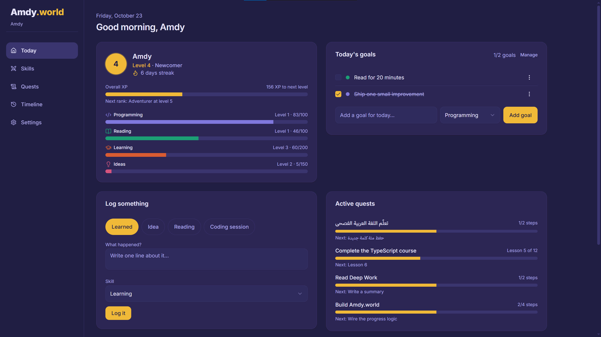
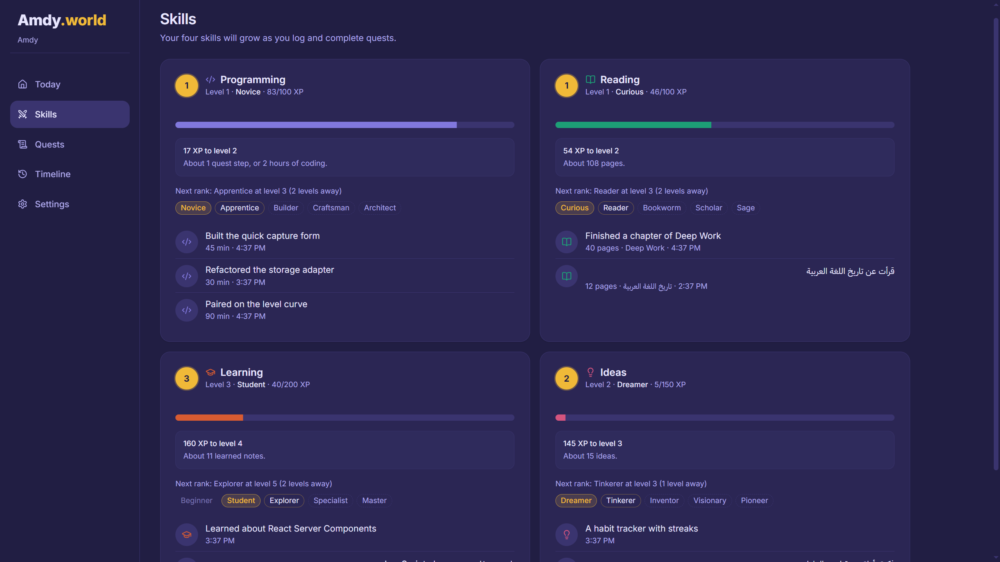
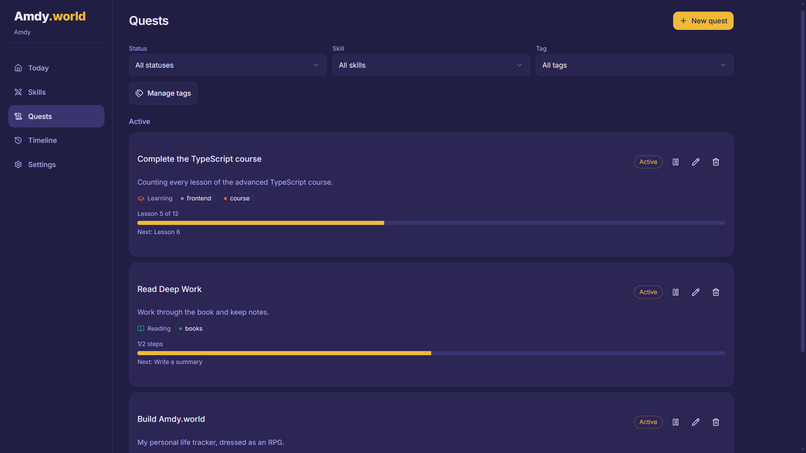

# Amdy.world
**Live demo:** https://amdy-world.vercel.app


A personal, local-first web app that turns tracking your own growth into an RPG:
log what you learn, read, and build, and your skills level up. Projects and
courses become quests. Everything runs in your browser: no account, no backend,
and no data leaves your device. Your data lives in IndexedDB.

## Screenshots





## Features

- Quick logging for things you learned, ideas, reading, and coding sessions, each awarding XP
- Four skills with levels and ranks: Programming, Reading, Learning, and Ideas
- Quests: step-based projects, and counter-based courses or books with milestones
- Daily goals, including recurring ones, and a day streak
- A timeline with search, a skill filter, and list or grid views
- Notes in Arabic, English, or both
- Backup and restore as a JSON file

## Tech stack

React, TypeScript, Vite, Tailwind CSS v4, shadcn/ui, Dexie (IndexedDB), Zod, and Vitest.

## Requirements

- Node >= 22.12
- pnpm (this project uses **pnpm only**; do not use npm or yarn)

## Run it

```bash
pnpm install
pnpm dev
```

Then open the URL Vite prints (usually http://localhost:5173).

## Scripts

| Script               | What it does                                     |
| -------------------- | ------------------------------------------------ |
| `pnpm dev`           | Start the dev server with HMR                    |
| `pnpm build`         | Type-check (`tsc -b`) and build for production   |
| `pnpm preview`       | Serve the production build locally               |
| `pnpm lint`          | Run ESLint                                       |
| `pnpm test`          | Run the Vitest suite once                        |
| `pnpm format`        | Format the codebase with Prettier                |
| `pnpm format:check`  | Check formatting without writing                 |
| `pnpm check`         | Run formatting, lint, build, and tests in one go |

## Folder structure

```
src/
  components/   Feature-grouped UI (quests/, skills/, settings/, …)
                plus shared ui/ primitives (shadcn/ui) and common/ pieces
  hooks/        React context and action hooks; the only place that
                talks to storage
  lib/          Pure, tested business logic
    progress/     XP, levels, streaks, ranks (derived, never stored)
    goals/        Daily goal materialization and helpers
    schema/       Zod schemas and default factories
    storage/      StorageAdapter interface + Dexie/InMemory implementations
  pages/        Route screens
```

A few rules shape the code:

- **Storage isolation.** Only `src/lib/storage/` imports Dexie or IndexedDB.
  Everything else uses the `StorageAdapter` interface.
- **Derived progress.** XP, levels, and streaks are never stored; they are
  computed from entries, quests, and goals by pure functions.
- **One rules file.** Every XP value and the level curve live in
  `src/lib/progress/rules.ts`; there are no magic numbers elsewhere.
- **Copy in one place.** All user-facing strings live in `src/lib/copy.ts`.

## Storage adapter (and how to swap it)

The app starts local-only but is built to move to a server later.

- The interface lives in `src/lib/storage/types.ts`.
- `DexieAdapter` is the current implementation (IndexedDB via Dexie);
  `InMemoryAdapter` is used in tests.
- A single instance is created in `src/lib/storage/index.ts`. To move to a
  server, implement a new adapter (for example `ApiAdapter`) with the same
  methods and change that one line — the rest of the app does not change.

## Backup and your data

Your data is stored **only in this browser**, so clearing site data, using
private mode, or switching browsers/devices loses it. Use Settings → Download backup to download a JSON snapshot, and **Import backup** to restore one. Imports are
validated with Zod before anything is written. Downloaded backups are named
`amdy-world-backup-YYYY-MM-DD.json` and are git-ignored.

## Make it yours

Fork it and change what you like:

- XP values and the level curve: `src/lib/progress/rules.ts`
- Rank names: `src/lib/copy.ts`; rank level thresholds: `src/lib/ranks.ts`
- Skills (names, icons, colors): `src/lib/skills.ts`
- Theme colors: `src/index.css`

## License

MIT — see [LICENSE](LICENSE).
